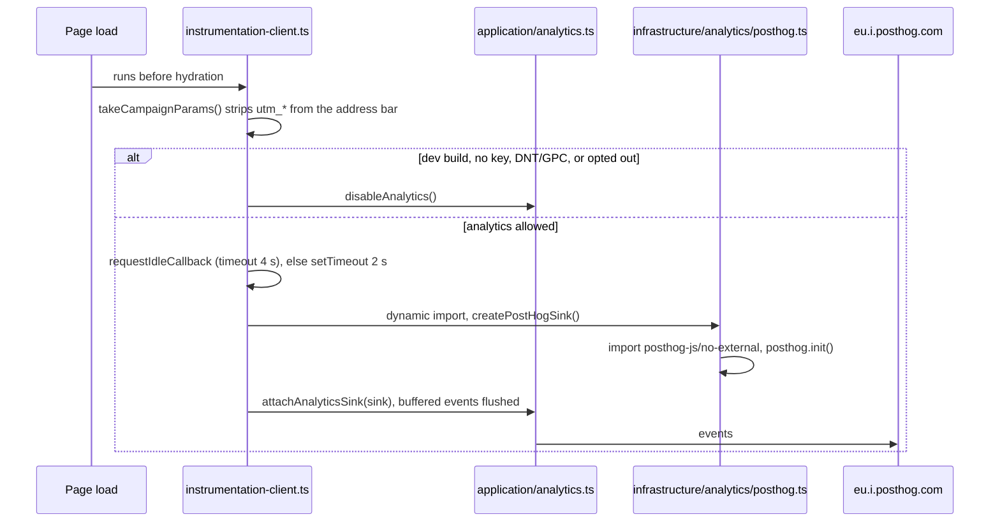

# Analytics

Merre sends anonymous, cookieless usage statistics to PostHog EU Cloud. This page covers why PostHog was chosen, how the integration works, every event the app sends, the privacy rules for new events, local testing, and the first insights worth building. Account setup and Vercel configuration are in [OPERATIONS.md](OPERATIONS.md#posthog-first-time-setup). What visitors are told is on the privacy page (`/privacy/`, texts in `src/presentation/i18n/messages/privacy.ts`).

## Summary

- Vendor: PostHog EU Cloud (Frankfurt), browser SDK `posthog-js` pinned to `1.445.5`, loaded from the `posthog-js/no-external` entry point.
- No cookies, no `localStorage`, no `sessionStorage` written by analytics (`cookieless_mode: "always"`). PostHog counts visitors with a hash computed on its servers.
- No autocapture, no session recording, no surveys, no feature flags, no experiments.
- Analytics runs only when all of these hold:
  - it is a production build (`NODE_ENV === "production"`),
  - `NEXT_PUBLIC_POSTHOG_KEY` was set when the site was built,
  - the browser sends neither Do Not Track nor Global Privacy Control,
  - the visitor has not switched statistics off on `/privacy/` (`localStorage` key `merre.analyticsOptOut` = `"1"`).
- When any condition fails, the SDK is not loaded and nothing leaves the browser. The privacy page shows the state: on, off (opted out), off because of the browser setting, or no statistics on this deployment (no key).

## Why PostHog

Requirements: no consent banner (so no cookies or other identifiers stored in the browser), EU hosting, custom events with several properties, funnels, error reports and load-speed data in one place, and no fixed monthly fee for a student project with uneven traffic.

PostHog pricing, from [posthog.com/pricing](https://posthog.com/pricing), checked on 2026-11-22:

| Item | Free plan | Pay-as-you-go plan |
| --- | --- | --- |
| Product and web analytics | 1M events per month | Same free allowance, then billed per event |
| Error tracking | 100K exceptions per month | Same free allowance, then billed per exception |
| Session replay, feature flags, surveys (not used) | 5K recordings, 1M flag requests, 1,500 responses per month | Same, then billed per unit |
| Card required | No | Yes |
| Over the free allowance | Usage stops; extra events are dropped | Billed per unit, no minimum spend; billing limits can be set per product |
| Projects | 1 | 6 |
| Data retention | 1 year | 2 years |

The per-unit rates above the free allowance are shown by the calculator on the pricing page; check it there before upgrading. The free allowances reset every month and do not roll over.

PostHog also offers `cookieless_mode`, where the browser stores nothing and PostHog derives a daily visitor id on its servers from `hash(team_id, daily_salt, ip_address, user_agent, hostname)`; the salt is deleted after the day ([PostHog cookieless tracking docs](https://posthog.com/docs/privacy/cookieless-tracking), checked 2026-11-22).

Alternatives considered (facts from each vendor's pricing page, checked 2026-11-22):

| Option | Why it was not chosen |
| --- | --- |
| Google Analytics 4 | Recognises visitors with first-party cookies, so EU use needs a consent banner. Data goes to an advertising company. Collects more than Merre needs. |
| Plausible Cloud | Cookieless and hosted in the EU, but there is no free plan: a 30-day trial, then from $9 per month for 10k monthly pageviews. Funnels are only in the Business plan. No error tracking. |
| Umami Cloud | Cookieless with a free Hobby plan, but that plan is capped at 100K events per month, 1 website and 6 months of data; the next plan is $20 per month. No error tracking. |
| Vercel Web Analytics | Built into the current host and cookieless, but the Hobby plan (50,000 events per month, 1-month reporting window) has no custom events. On Pro, custom events cost $0.03 per 1K events and carry at most 2 properties (8 with the $10 per month Web Analytics Plus add-on, which is also needed for UTM parameters). Merre's events carry up to 6 properties. |
| Mixpanel | Free plan with up to 1M events per month and EU data residency, but its browser SDK keeps a visitor id in a cookie or `localStorage`, which would again need consent. |

## How it works



The pieces:

| File | Role |
| --- | --- |
| `src/application/analytics.ts` | The facade. `AnalyticsEvents` is the typed event catalogue. `track()` and `trackException()` never throw. Before the adapter is attached, calls are buffered (the newest 50 are kept). `disableAnalytics()` drops the buffer and ignores later calls for the rest of the page load. `analyticsQuery()` normalises search text. Tests: `src/application/analytics.test.ts`. |
| `src/infrastructure/analytics/posthog.ts` | The PostHog adapter, implementing the `AnalyticsSink` port. It is a separate chunk, imported only when analytics is allowed. |
| `src/instrumentation-client.ts` | The composition root. Next.js runs this file in the browser before the app becomes interactive (see `node_modules/next/dist/docs/01-app/03-api-reference/03-file-conventions/instrumentation-client.md`). |
| `src/presentation/analytics/consent.ts` | `readOptOut()`, `writeOptOut()` (key `merre.analyticsOptOut`) and `browserSignalsNoTracking()` (`navigator.doNotTrack === "1"`, `window.doNotTrack === "1"` or `navigator.globalPrivacyControl === true`). |
| `src/presentation/analytics/campaign.ts` | `takeCampaignParams()`: reads `utm_source`, `utm_medium`, `utm_campaign`, `utm_content`, `utm_term` from the landing URL (each capped at 100 characters) and removes them from the address bar. |
| `src/presentation/analytics/useTrackedSearch.ts` | Sends `search_performed` once the search text has stayed unchanged for 1.2 s and its result count is known. |
| `src/presentation/pages/PrivacyView.tsx` | The privacy page and its opt-out switch. |
| `scripts/build-precache.ts` | Leaves the PostHog SDK chunk (any `.js` file containing `[PostHog.js]`) out of the service worker precache, so visitors with analytics off never download it. Visitors with analytics on fetch it once; the worker then serves it cache-first. |

### PostHog configuration

Set in `createPostHogSink()` in `src/infrastructure/analytics/posthog.ts`:

| Option | Value | Effect |
| --- | --- | --- |
| `api_host` | `NEXT_PUBLIC_POSTHOG_HOST`, default `https://eu.i.posthog.com` | EU Cloud ingestion |
| `defaults` | `"2026-01-30"` | Pins the SDK's default behaviour to that configuration snapshot |
| `cookieless_mode` | `"always"` | Nothing stored in the browser; visitors counted by the server-side hash. Needs the project setting described in [OPERATIONS.md](OPERATIONS.md#posthog-first-time-setup), otherwise PostHog discards the events |
| `capture_pageview` | `"history_change"` | `$pageview` on load and whenever the path changes. Query-only changes do not count, because the indoor screen rewrites `?to=` with `history.replaceState` on every selection |
| `capture_pageleave` | `true` | `$pageleave` |
| `autocapture` | `false` | No automatic click or form capture |
| `disable_session_recording`, `disable_surveys`, `disable_web_experiments` | `true` | Off |
| `advanced_disable_flags` | `true` | No feature flag requests and no remote configuration, so switches in the PostHog dashboard cannot turn on extra capture |
| `disable_external_dependency_loading` | `true` | The SDK never loads further scripts, so the CSP needs no PostHog script host |
| `capture_exceptions` | `true` | Uncaught errors become `$exception` events |
| `capture_performance` | `{ web_vitals: true, network_timing: false }` | `$web_vitals` events; no network timing |
| `respect_dnt` | `true` | The SDK checks Do Not Track as well |
| `before_send` | adds the stored `utm_*` values | Every event of the page load carries the landing page's campaign parameters |

### Campaign parameters

The flyer's QR codes carry `utm_source=szorolap&utm_medium=print` (see [flyer/README.md](flyer/README.md)). The SDK reads campaign parameters from the current URL, but the indoor screen rewrites its URL on mount, before the SDK loads. So `takeCampaignParams()` runs first in `instrumentation-client.ts`, on every page load and even with analytics off: it keeps the values for the adapter's `before_send` hook and removes them from the address bar. A link copied after scanning a QR code therefore does not count as flyer traffic again.

Room links in the city search results carry `src=search` (`buildingHref(..., { source: "search" })` in `src/application/links.ts`). The indoor screen reads it once for the `room_selected` source and drops it from the address bar with its next URL sync.

## What is collected

Automatic events from the SDK:

| Event | When |
| --- | --- |
| `$pageview` | First load after the SDK starts, and every path change |
| `$pageleave` | Leaving a page |
| `$web_vitals` | Core Web Vitals measured by the SDK |
| `$exception` | Uncaught errors (`capture_exceptions`) and calls to `trackException()` |

Each event also carries the SDK's standard properties, such as the page URL and path, referrer, browser, operating system, device type, screen size and browser language. Page URLs can contain room and anchor ids (`/building/ba/?to=F.06&from=doberdo-entrance`), never search text.

Not collected: names, e-mail addresses, accounts, precise location (there is no GPS or indoor positioning in the app), session recordings, clicks outside the named events, and free text other than the normalised search query.

GeoIP: according to PostHog's cookieless tracking docs (checked 2026-11-22), the IP address is stripped before GeoIP enrichment and bot detection run in cookieless server hash mode, so events carry no country or city.

Browser storage: analytics writes nothing. The app itself uses three `localStorage` keys: `merre.locale` (language), `merre.installDismissed` (install banner dismissed) and `merre.analyticsOptOut` (statistics switched off).

## Event catalogue

The source of truth is the `AnalyticsEvents` interface in `src/application/analytics.ts`. All ids are the ids used in the data files and URLs (`ba`, `F.06`, `main-entrance`), never display names.

| Event | When it fires | Properties | Sent from |
| --- | --- | --- | --- |
| `search_performed` | The search text has stayed unchanged for 1.2 s and its results are known | `screen`: `city` (city sheet), `building` (indoor room search) or `origin` (start point picker); `query`: trimmed, lower-cased, whitespace collapsed, at most 40 characters; `rooms`: number of room results shown (at most 12 on `city` and `origin`, 30 on `building`); `buildings`: number of building results, `city` only | `src/presentation/analytics/useTrackedSearch.ts`, used by `city/SearchResults.tsx`, `building/panels/ExplorePanel.tsx`, `building/panels/OriginPicker.tsx` |
| `building_selected` | A building card opens on the city screen | `building`; `source`: `map` (building or label tapped on the map), `list` (building list), `search` (search results) | `src/presentation/city/CityOverview.tsx` |
| `room_selected` | A room is selected on the indoor screen | `building`; `room`; `source`: `search` (indoor search, or a city search result link with `src=search`), `list` (rooms by level), `map` (tapped in the 3D view), `link` (opened from a URL with `?to=`: a shared link, a QR code), `nearest` (a "Nearest" chip) | `src/presentation/building/useNavigator.ts`, sources set in `BuildingScreen.tsx` |
| `nearest_requested` | A "Nearest" chip is pressed (restroom, café, reception, aula) | `building`; `category`: the chip's first category (`restroom`, `cafe`, `reception`, `lobby`); `found`: whether a route to one of the candidates exists | `src/presentation/building/useNavigator.ts` |
| `origin_changed` | A start point is picked in the origin picker | `building`; `origin_type`: `anchor` or `unit`; `origin`: anchor or unit id | `src/presentation/building/useNavigator.ts` |
| `route_started` | "Route here" is pressed on the room card | `building`; `room`; `origin`; `step_free`; `distance_m`: route length rounded to metres; `steps`: number of instruction cards, including the street approach step | `src/presentation/building/useNavigator.ts` |
| `route_completed` | "I'm here" is pressed on the last step | `building`; `room`; `step_free` | `src/presentation/building/useNavigator.ts` |
| `route_not_found` | A selected room has no route with the current start point and step-free setting. Sent when that combination first occurs, not on every render | `building`; `room`; `origin`; `step_free` | `src/presentation/building/useNavigator.ts` |
| `step_free_toggled` | The step-free switch in the route panel is flipped | `building`; `enabled`: the new value | `src/presentation/building/useNavigator.ts` |
| `directions_opened` | "Directions" ("Navigálás") on a city building card hands over to the phone's maps app | `building`; `platform`: `apple` or `google` | `src/presentation/city/BuildingCard.tsx` |
| `link_shared` | A room link was shared or copied. Not sent when the share sheet is dismissed or copying fails | `building`; `room`; `method`: `native` (Web Share API) or `clipboard` | `src/presentation/building/panels/PlacePanel.tsx` |
| `problem_report_opened` | The "Wrong room position or route? Let us know" link on the room card is opened | `building`; `room` | `src/presentation/building/panels/PlacePanel.tsx` |
| `language_changed` | The language toggle switches to the other language | `locale`: `hu` or `en` | `src/presentation/ui/LanguageToggle.tsx` |
| `install_prompt_answered` | The browser's install prompt, opened from the install banner, is answered | `outcome`: `accepted` or `dismissed` | `src/presentation/pwa/useInstallPrompt.ts` |
| `map_unavailable` | A map cannot be shown | `screen`: `city` or `building`; `reason`: `failed` (city map could not start, or its WebGL context was not restored), `tiles` (city base tiles did not load: the map is degraded), `webgl` (indoor 3D view could not start). The type also allows `screen: "entrance"`, which no code sends yet | `src/presentation/city/CityOverview.tsx`, `src/presentation/building/BuildingScreen.tsx` |
| `building_load_failed` | The building data chunk failed to load; the retry screen is shown | `building` | `src/presentation/building/BuildingExplorer.tsx` |

Handled errors sent with `trackException()` (as `$exception`):

| Source | Extra properties |
| --- | --- |
| `src/app/error.tsx` (route error boundary) | `boundary: "route"` |
| `src/app/global-error.tsx` (root layout error boundary) | `boundary: "global"` |
| `src/presentation/building/BuildingExplorer.tsx` (data chunk failed) | `building` |

## Privacy rules for new events

Every new event or property must keep the promises on the privacy page.

- Send ids, counts, enums and rounded numbers. Never names, e-mail addresses, display names of people, or free text. The only free text allowed is the search query, and only through `analyticsQuery()`.
- Never call `posthog.identify()`, `alias()` or set person properties, and do not add any id that survives the page load. Cookieless mode depends on it.
- Do not store anything in the browser for analytics.
- Do not turn on autocapture, session recording, surveys, feature flags or heatmaps. They record more than the privacy page lists, and some need browser storage or extra script hosts.
- Do not send precise location. The app has no positioning; keep it that way unless the privacy page and the `Permissions-Policy` header in `vercel.json` are changed on purpose.
- Fire on a user action or a state change, not per keystroke or per frame. Debounce like `useTrackedSearch`.
- Property names are `snake_case`; values are small enums where possible.
- If an event records a new kind of information, update both languages of `src/presentation/i18n/messages/privacy.ts` (including the `updated` date) in the same pull request.

## How to add an event

1. Add the event and its properties to `AnalyticsEvents` in `src/application/analytics.ts`, with a short doc comment if the trigger is not obvious.
2. Call `track("event_name", { ... })` from the presentation layer, in an event handler or a hook. The domain layer does not call analytics.
3. Add a row to the [event catalogue](#event-catalogue).
4. Check the [privacy rules](#privacy-rules-for-new-events); update the privacy page texts if needed.
5. Test it with a production build (below). PostHog accepts new event names without any schema change.

`track()` is typed: an unknown event name or a wrong property is a type error, which `npm run typecheck` catches.

## Testing locally

`npm run dev` never sends analytics (`NODE_ENV` is not `production`). Use a production build with a key:

```bash
NEXT_PUBLIC_POSTHOG_KEY=phc_your_project_key npm run build
```

```bash
npm run preview
```

Then open `http://localhost:3000/?__posthog_debug=true` in a normal browser window. With that query parameter the SDK logs every event it captures to the console. Only open it on `/`: the indoor screen rewrites its query string before the SDK starts, so the flag is gone there by the time it is read.

Checks:

- In the console, `navigator.doNotTrack` must not be `"1"` and `navigator.globalPrivacyControl` must not be `true`; otherwise analytics stays off. Some browsers send Global Privacy Control by default.
- In DevTools, Network: after the page is idle, requests go to `https://eu.i.posthog.com/e/`. Payloads use `distinct_id: "$posthog_cookieless"`; the real visitor hash is computed by PostHog.
- In DevTools, Application: no cookies and no analytics keys in `localStorage` or `sessionStorage`.
- In PostHog, the Activity view lists the incoming events.
- The PostHog SDK drops events from browsers whose user agent looks like a bot, including headless Chrome (`HeadlessChrome`). Automated tests with a headless browser send nothing; use a headed browser.
- `npm run preview` serves `out/` without the headers from `vercel.json`, so the Content Security Policy is not tested locally. Check it on a Vercel preview or production deployment ([OPERATIONS.md](OPERATIONS.md#verifying-a-deployment)).

Local test events land in the same PostHog project as production when you use the production key (the free plan has one project). Filter them out with the project's "Filter out internal and test users" setting, for example `$host` is not `localhost:3000`.

## First insights and dashboards

Suggested starting set:

| Insight | How to build it |
| --- | --- |
| Daily visitors | Web analytics dashboard, or a Trends insight on `$pageview` with unique users per day. Weekly and monthly unique counts are inflated, because the cookieless visitor id changes every day |
| Search terms with zero results | Trends on `search_performed` where `rooms = 0` (and `buildings = 0` for `screen = city`), broken down by `query`. These are missing aliases or rooms |
| Selection to arrival funnel | Funnel `room_selected` → `route_started` → `route_completed`, broken down by `room_selected.source`. Keep the conversion window within a day |
| Unroutable rooms | Trends on `route_not_found`, broken down by `room` and `step_free`. Each entry is a data problem to fix in `src/data/buildings/` |
| Top rooms | Trends on `room_selected` (and `route_started`), broken down by `room` |
| Flyer traffic | Trends on `$pageview` where `utm_source = szorolap`, broken down by `$pathname` (`/` is the front QR code, `/building/ba/` the F.06 code on the back) |
| Error rate | `$exception` per day against `$pageview`, plus `building_load_failed` and `map_unavailable` broken down by `screen` and `reason`. Error tracking lists the exceptions as issues |
| Web vitals | The Web vitals view in Web analytics, from `$web_vitals` |
| Step-free use | `route_started` broken down by `step_free`; `step_free_toggled` |

## Known gaps

- **Opting out takes full effect on the next page load.** With `cookieless_mode: "always"`, PostHog ignores `opt_out_capturing()` (stated in PostHog's cookieless tracking docs and visible in the SDK source). After the switch on `/privacy/` is turned off, the app's own events stop at once, but the SDK's automatic `$pageview`, `$pageleave`, `$web_vitals` and `$exception` events continue until the page is reloaded. From the next page load nothing is sent.
- **Unique visitors are per day.** The same person counts again each day, and two people on the same network with the same browser version can count as one.
- **No country data.** See [GeoIP](#what-is-collected).
- **`rooms` in `search_performed` is capped** by the number of results each screen shows (12 or 30), so it is not the total number of matches.
