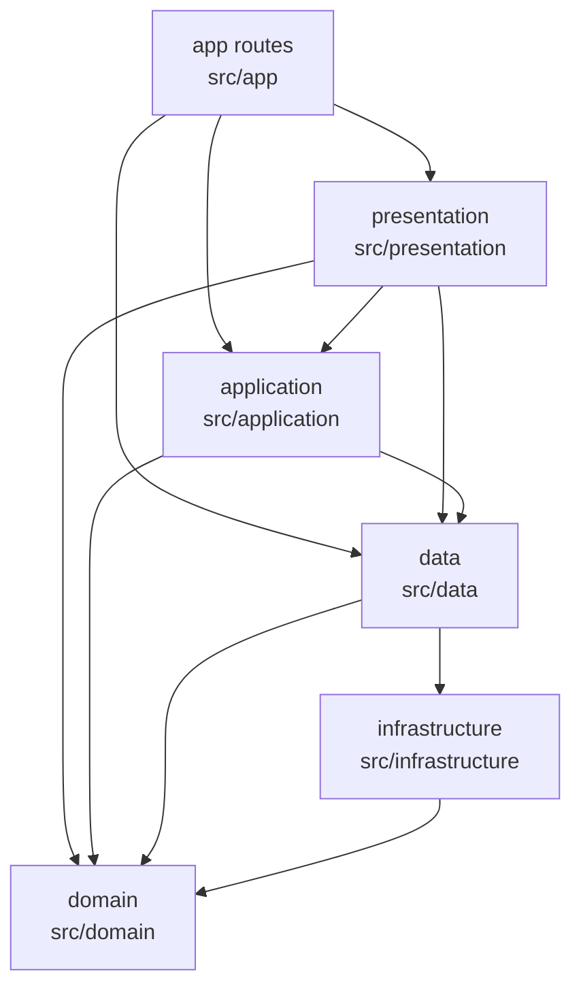

# Architecture

Merre is a static Next.js app. All logic runs in the browser. Routing, search and data mapping are plain TypeScript with no framework imports; React and three.js sit on top.

This document covers the layers and the dependency rule, the runtime flow of a route request, the main design decisions with their trade-offs, performance, accessibility, the offline strategy, testing, and known limitations. The data format is in [DATA_MODEL.md](DATA_MODEL.md).

## Layers

| Layer | Folder | Responsibility | May import |
| --- | --- | --- | --- |
| Domain | `src/domain/` | Indoor and campus models, 2D geometry, route graph, A*, step instructions, validation, room search | Itself only |
| Application | `src/application/` | Small use cases: maps hand-off URLs, shareable building links, the room search index over all buildings, app name and texts | Domain, data |
| Infrastructure | `src/infrastructure/` | Maps the on-disk GeoJSON format to the domain model | Domain |
| Data | `src/data/` | Shipped datasets and their loaders: campus buildings, building BA | Domain, infrastructure |
| Presentation | `src/presentation/` | React components, the three.js scene, MapLibre map, i18n messages, PWA hooks | Domain, application, data |
| App routes | `src/app/` | Next.js routes, layout, manifest, icons | Application, data, presentation |

`scripts/` (data validation, plan rendering, icon generation, precache manifest, bootstrap tools) imports from `src/` with relative paths and is not part of the app bundle.



### The dependency rule

Dependencies point towards the domain. The domain imports nothing from the other layers, and no lower layer imports from `presentation` or `app`.

How this is kept:

- The domain is pure TypeScript. Production files in `src/domain/` import only each other, through relative paths. There are no imports of React, three.js, Next.js, MapLibre or `@/` aliases, and no use of `window` or `document`. The only external import in the folder is `vitest` in test files.
- `src/infrastructure/` and `src/application/` import only the domain (and, for the room search index, `src/data/`).
- You can re-check this at any time:

```bash
grep -rn "from \"@/\|from \"react\|from \"three\|from \"next" src/domain --include=*.ts | grep -v "\.test\."
```

The command prints nothing when the rule holds.

The rule is enforced by convention and code review. There is no lint rule for import boundaries yet; adding one (for example `no-restricted-imports` per folder) is a candidate improvement.

Two points where the table above differs from a strict onion layering:

- `data` is its own leaf layer. It wraps JSON files and calls the infrastructure mapper at module load, so it depends on `infrastructure` and `domain`.
- Presentation components for the city screen import the campus dataset from `@/data/campus` directly instead of going through `application`. The indoor screen takes the loaded building bundle from `@/data/buildings`.

### What lives where

- `domain/indoor/model.ts`: `IndoorBuilding`, `Level`, `Unit`, `Opening`, `Walkway`, `Connector`, `Anchor`, `Amenity`, `Georeference`.
- `domain/routing/`: `graph.ts` (graph construction and snapping), `find-route.ts` (A*, nearest-unit search), `costs.ts` (cost model), `instructions.ts` (route to steps), `condense.ts` (steps to cards), `validate.ts` (data checks), `types.ts` (route and step types).
- `domain/search/`: text folding, room number normalisation, category keywords, typo-tolerant scoring.
- `domain/geometry/`: `Vec2` and polygon helpers.
- `domain/campus/model.ts`: `CampusBuilding` and `Faculty`.
- `application/`: `directions.ts` (Apple Maps or Google Maps walking directions URL), `links.ts` (`buildingHref`), `room-search.ts` (lazy search index over all indoor buildings), `app-info.ts`.
- `infrastructure/indoor/geojson-mapper.ts`: `mapBuilding(manifest, levelFiles)`. It is the only code that knows the on-disk format.
- `presentation/building/`: `useNavigator.ts` (navigation state), `stepText.ts` (steps to text), `scene/BuildingScene.ts` (three.js), `BuildingCanvas.tsx` (React shell), panels and level switcher.
- `presentation/city/`: the MapLibre city map and its list, search and detail card. This screen is under active development; read the files for current detail.
- `presentation/i18n/`: `I18nProvider` and message files per screen (`common`, `building`, `city`, `pwa`, `ui`), Hungarian and English.
- `presentation/pwa/`: service worker registration, update toast, offline chip, install banner.
- `public/sw.js`: the service worker.

## Runtime flow

A deep link such as `/building/ba/?to=F.06&from=doberdo-entrance&sf=1` goes through these stages.

```mermaid
flowchart LR
    url["URL<br/>/building/ba/?to=F.06<br/>&from=...&sf=1"]
    page["app route<br/>building/[buildingId]/page.tsx"]
    load["loadIndoorBuilding<br/>lazy chunk: GeoJSON + mapBuilding"]
    nav["useNavigator<br/>reads ?to, ?from, ?sf"]
    graph["buildRouteGraph<br/>walkways + connectors"]
    astar["findRoute<br/>A*"]
    steps["buildSteps<br/>depart / turn / connector / arrive"]
    cond["condenseSteps<br/>instruction cards"]
    text["describeStep<br/>hu / en text"]
    panels["panels + banner<br/>text step list"]
    scene["BuildingScene<br/>three.js"]

    url --> page --> load --> nav
    nav --> graph --> astar --> steps --> cond
    cond --> text --> panels
    astar --> scene
    cond --> scene
```

1. **Route.** The page is prerendered once per building id (`generateStaticParams` over the buildings that have indoor data). `BuildingExplorer` loads the building through a dynamic import, which is a separate JavaScript chunk.
2. **Navigator.** `useNavigator` builds the route graph once per building (`useMemo`). After mount it reads `to`, `from` and `sf` from `window.location.search`, selects the destination and switches to the "place" phase. `to` matches a unit id or a room number. `from` matches an anchor id or a unit id.
3. **Route search.** `findRoute` runs A* between all doors of the origin and all doors of the destination.
4. **Steps.** `buildSteps` converts the route legs into structured steps. `condenseSteps` merges noise into instruction cards: short walks into a lift or stair, a short exit followed by a turn, and sidesteps (a short turn undone by the opposite turn, or a short slight bend right before a real turn).
5. **Text.** `describeStep` in the presentation layer renders each step as a card (icon, title, subtitle) in the active language.
6. **Scene and panels.** The route legs and the current step focus drive `BuildingScene`; the same cards populate the route panel and the instruction banner.
7. **URL sync.** `useNavigator` keeps the address bar in sync with `history.replaceState`, without navigation.

The navigator has three phases: `explore` (nothing selected), `place` (a destination is selected) and `route` (the route is on screen, either as an overview or one step at a time).

A route that starts at an entrance anchor (`kind: "entrance"`) begins with an "approach" step. It is shown on a MapLibre street map (`EntranceMap`) with the door pinned there, before the 3D exploded view takes over for the indoor steps.

On the city map the user can rotate the view (pitch stays fixed). When a building or campus is selected, the map slowly orbits (`src/presentation/city/orbit.ts`); any user input stops the orbit.

## Design decisions

### Static export, no backend

`next.config.ts` sets `output: "export"`. The build is HTML, JS, JSON and images in `out/`.

- Gain: hosting on any static host, no server to run, no user data collected or stored, offline use is straightforward.
- Cost: no server-side search, no per-user features, no live data. Query strings are read in the browser after load, so a deep link opens the building page and the client applies the parameters. Pages are prerendered in Hungarian; English is applied after hydration.

### GeoJSON as the single source of truth

The per-level GeoJSON files and `building.json` are committed and edited directly. The domain model is derived from them at load time by `mapBuilding`.

- Gain: data can be edited in QGIS or by hand and reviewed as a diff; one format feeds the app, the validator and the plan renderer.
- Cost: the coordinates are metres in a building-local frame, not WGS84, so general GeoJSON tools show them on the wrong place unless the frame is handled. The bootstrap scripts are a one-time derivation, not a build step; running them again would overwrite hand corrections.

### Explicit walkway network and connectors instead of a navmesh

Walkable centre lines are drawn as `walkway` features. Doors, entrances and connector stops are snapped to them. Vertical links are `connector` features that group one stop per level.

- Gain: a small graph, predictable routes along corridors, a cost model that is easy to reason about (stairs and lifts have explicit penalties), simple validation (every destination must be reachable from the default entrance), and step-free routing as an edge filter.
- Cost: someone has to draw the walkways. A route follows the drawn line, not the free space of a room. Large open spaces such as the aula are approximated by lines.

### Structured steps, text rendered in the presentation layer

The domain returns steps as data (`depart`, `turn` with a direction, `connector`, `arrive`, with distances, landmarks and sides). The presentation layer turns them into Hungarian or English text with the message files.

- Gain: the domain has no language knowledge, so adding a language touches only message files; the same steps drive the 3D focus, the banner and the list; steps are easy to test as data.
- Cost: two places must agree on the step vocabulary (domain types and `stepText.ts`); a new step type needs both.

### Imperative three.js scene behind a thin React wrapper

`BuildingScene` is a class that owns the renderer, camera, controls, meshes and animation loop. `BuildingCanvas` creates it once per building and forwards props to its setters (`setMode`, `setRoute`, `setHighlight`, `setInsets`, `focus`).

- Gain: React re-renders never rebuild the scene; animation state (damped camera, fading levels, route draw-on) lives where the render loop is; cleanup is one `dispose()` call.
- Cost: the scene is not declarative, so its behaviour is covered by manual checks rather than unit tests; React props map to setters by hand.

### Hand-written service worker

`public/sw.js` is about 180 lines with no libraries. A build script writes the list of files to precache.

- Gain: no build-time dependency, full control over update behaviour (a new worker waits until the user accepts the update toast), small and readable.
- Cost: the caching logic is ours to maintain and test by hand.

### Lazy per-building data chunks

`src/data/buildings/index.ts` maps a building id to `() => import("./ba")`. Each building's JSON is bundled into its own chunk, loaded when that building is opened (or when the room search index is built).

- Gain: the city screen does not pay for indoor data; adding buildings does not grow the first load.
- Cost: the loader table is edited by hand when a building is added.

## Performance notes

These are properties of the current code, not measurements.

- The indoor data and the three.js scene code are not part of the city screen load: the building data is a dynamic import, and the city map component is loaded with `next/dynamic` and `ssr: false`.
- The route graph is built once per building and reused; route requests run A* with a binary heap and a straight-line heuristic. The search index is built once on first use and cached.
- The three.js renderer is created with `powerPreference: "low-power"` and a device pixel ratio capped at 2. Unit outline edges are merged into one `LineSegments` per level with `mergeGeometries`. Geometries and materials are disposed when the scene is disposed.
- The scene runs a `requestAnimationFrame` loop while it is mounted, but only draws a frame while something is animating (levels moving, camera flight, route shown) or after a change (interaction, resize, a setter call). The loop is cancelled on dispose.
- Hashed build assets under `/_next/static/` are served cache-first by the service worker. Map tiles and glyphs are cached stale-while-revalidate and capped at 400 entries.
- Walkway nodes are merged at 1 cm resolution; features farther than 6 m from a walkway are not connected (and fail validation).

## Accessibility

- **Text alternative.** Every route is available as a list of text instructions, independent of the 3D view. If WebGL is unavailable, `BuildingScreen` shows a message and the search, place and route panels keep working without the model.
- **Reduced motion.** The scene reads `prefers-reduced-motion`: it disables camera damping, the draw-on animation of the route, the pulse and the moving chevrons, and moves the camera immediately. The city screen wraps its animations in `MotionConfig reducedMotion="user"`, and the bottom sheet uses `useReducedMotion`.
- **Keyboard and assistive technology.** Controls are native buttons or links with accessible names. The language toggle, chips and map labels expose `aria-pressed`. The bottom sheet collapses with Escape on small screens. Search results and the share status use `aria-live`; the offline chip uses `role="status"` and the update toast `role="alert"`. Primary icon buttons are 44 px.
- **Limits.** The 3D scene itself is operated by pointer and touch (orbit controls); keyboard users use search and the step list. The 3D canvas has a `role="img"` label with the building name in the active language.

## Offline strategy

- **Install.** On install, `sw.js` fetches `/precache-manifest.json` (written by `scripts/build-precache.ts` after `next build`) and stores every listed URL in a cache named `merre-precache-<version>`. The version is a hash of the URL list and file sizes, so each changed build gets a fresh cache. A single failing URL does not abort the install.
- **Precached content.** Prerendered pages (`index.html` files), `_next/static/*`, icons, `manifest.webmanifest`, and RSC payload `.txt` files used by client navigation.
- **Navigations.** Network-first with a 3 second timeout. Successful pages are stored under their query-less URL. When offline or slow, the cached page is served, matched without the query string, with the cached `/` as the last fallback.
- **Static assets.** `/_next/static/*` is cache-first.
- **Other same-origin requests.** Stale-while-revalidate in `merre-runtime-v1`.
- **Map tiles.** Requests to `tiles.openfreemap.org` are stale-while-revalidate in `merre-map-v1`, capped at 400 entries (oldest removed first). Only successful, non-opaque responses are stored. Tiles that were never viewed are not available offline.
- **Updates.** A new worker does not call `skipWaiting` on its own. The page shows an update toast; accepting it sends `SKIP_WAITING`, and the page reloads once when the new worker takes control. On activation, precaches of older builds are deleted; if the manifest cannot be fetched at that moment, nothing is deleted.
- **Never cached by the worker.** `/sw.js` and `/precache-manifest.json`.
- **Registration.** Production builds only, in `useServiceWorker`.

## Testing strategy

Tests run with Vitest in a Node environment (`vitest.config.ts`). They cover the pure layers and the shipped data:

| Area | Files | What is checked |
| --- | --- | --- |
| Routing | `src/domain/routing/*.test.ts` | Graph construction, A* results, step generation, condensing, validation, on a small demo building in `__fixtures__/` |
| Search | `src/domain/search/*.test.ts` | Normalisation of room numbers, scoring, typo tolerance |
| Mapper | `src/infrastructure/indoor/geojson-mapper.test.ts` | GeoJSON to domain mapping |
| Application | `src/application/directions.test.ts` | Maps platform detection and URL building |
| Step text | `src/presentation/building/stepText.test.ts` | Hungarian and English card text for steps, no card without a title, distance and duration formatting |
| Shipped data | `src/data/buildings/ba/ba.test.ts` | BA passes validation without errors, has the expected levels and rooms, every destination is routable with and without stairs, step-free routes avoid stairs, a multi-level route yields at most 12 cards |

`npm run validate:data` runs the same validator over every building as a CI gate. The React components and the three.js scene have no automated tests (only the pure `stepText` module in the presentation layer does); they are checked by hand. The CI workflow runs lint, typecheck, tests, data validation and the build.

## Known limitations and future work

- **No live positioning.** The user picks the start point manually (default entrance, another anchor or a room). There is no GPS or indoor positioning.
- **QR start points are not implemented.** The data model has `waypoint` anchors, and room links are designed to be printable as QR codes, but the BA data contains only entrance anchors (`main-entrance`, `doberdo-entrance`) and there is no scanner or QR-specific flow.
- **Only building BA has indoor data.** Other campus buildings appear on the city map only.
- **Estimated geometry.** All 192 BA units are `estimated`. Room positions inside a wing were spread along the corridor in ascending order, alternating sides. Corrections need on-site verification or surveyed plans.
- **Search normaliser is BA-specific.** The default building code list is `["ba"]`.
- **Georeference is used only for the entrance.** `building.json` carries the WGS84 origin and axis bearing; `georef.ts` uses them to pin the entrance door on the approach map, but the indoor model itself is not placed on the city map.
- **No import-boundary lint rule.** See [the dependency rule](#the-dependency-rule).
- **No automated tests for UI components and the 3D scene.**
- **Offline map.** Only tiles the user has already viewed are cached.
- **Hosting at the domain root only.** There is no `basePath` support.
