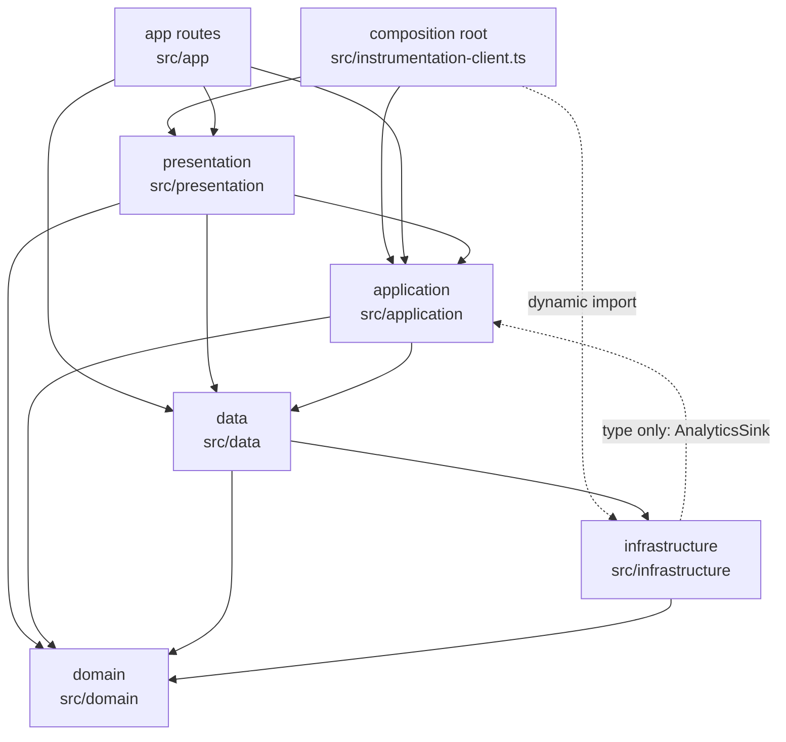

# Architecture

Merre is a static Next.js app. All logic runs in the browser. Routing, search and data mapping are plain TypeScript with no framework imports; React and three.js sit on top. The only outside services are map tiles (OpenFreeMap) and, in production builds with a key, anonymous usage statistics (PostHog EU Cloud).

This document covers the layers and the dependency rule, the runtime flow of a route request, analytics, error handling, pages and generated files, security headers, the main design decisions with their trade-offs, performance, accessibility, the offline strategy, testing, and known limitations. The data format is in [DATA_MODEL.md](DATA_MODEL.md); analytics in detail is in [ANALYTICS.md](ANALYTICS.md); deployment and operations are in [OPERATIONS.md](OPERATIONS.md).

## Layers

| Layer | Folder | Responsibility | May import |
| --- | --- | --- | --- |
| Domain | `src/domain/` | Indoor and campus models, 2D geometry, route graph, A*, step instructions, validation, room search | Itself only |
| Application | `src/application/` | Small use cases: maps hand-off URLs, shareable building links and problem-report links, the room search index over all buildings, app name, texts and site URL, the analytics facade (event catalogue, `track()`, the `AnalyticsSink` port) | Domain, data |
| Infrastructure | `src/infrastructure/` | Adapters: the GeoJSON mapper (on-disk format to domain model) and the PostHog adapter | Domain; the application's `AnalyticsSink` type (type-only import); vendor packages (`posthog-js`) |
| Data | `src/data/` | Shipped datasets and their loaders: campus buildings, building BA | Domain, infrastructure (GeoJSON mapper) |
| Presentation | `src/presentation/` | React components, the three.js scene, MapLibre maps, i18n messages, PWA hooks, analytics consent and campaign helpers, the privacy and status pages | Domain, application, data |
| App routes | `src/app/` | Next.js routes, layout, error boundaries, the 404 page, manifest, `robots.txt`, `sitemap.xml`, icons | Application, data, presentation |
| Composition root | `src/instrumentation-client.ts` | Runs in the browser before hydration: strips `utm_*` from the address bar, decides whether analytics may run, loads the PostHog adapter and attaches it to the facade | Application, presentation (`presentation/analytics/`), infrastructure (dynamic import of the PostHog adapter) |

`scripts/` (data validation, plan rendering, icon and link preview image generation, precache manifest, bootstrap tools) imports from `src/` with relative paths and is not part of the app bundle.



### The dependency rule

Dependencies point towards the domain. The domain imports nothing from the other layers, and no lower layer imports from `presentation` or `app`.

How this is kept:

- The domain is pure TypeScript. Production files in `src/domain/` import only each other, through relative paths. There are no imports of React, three.js, Next.js, MapLibre or `@/` aliases, and no use of `window` or `document`. The only external import in the folder is `vitest` in test files.
- `src/application/` imports only the domain and `src/data/` (for the room search index).
- `src/infrastructure/` imports the domain, vendor packages, and one type from the application layer (see the exceptions below).
- You can re-check this at any time. Each command prints nothing when the rule holds.

Domain is pure:

```bash
grep -rn "from \"@/\|from \"react\|from \"three\|from \"next" src/domain --include=*.ts | grep -v "\.test\."
```

Only the composition root and the data loaders reach into infrastructure:

```bash
grep -rln "@/infrastructure" src/app src/presentation src/application
```

No lower layer imports presentation or app routes:

```bash
grep -rn "@/presentation\|@/app/" src/domain src/application src/infrastructure src/data
```

Infrastructure imports only types from the application layer:

```bash
grep -rn "from \"@/application" src/infrastructure | grep -v "import type"
```

The rule is enforced by convention, code review and these commands. There is no lint rule for import boundaries yet; adding one (for example `no-restricted-imports` per folder) is a candidate improvement.

Points where the table differs from a strict onion layering:

- `data` is its own leaf layer. It wraps JSON files and calls the infrastructure mapper at module load, so it depends on `infrastructure` and `domain`.
- Presentation components for the city screen import the campus dataset from `@/data/campus` directly instead of going through `application`. The indoor screen takes the loaded building bundle from `@/data/buildings`.
- **Analytics is a port and an adapter.** The port, `AnalyticsSink`, is declared in `src/application/analytics.ts` next to the code that uses it. The adapter in `src/infrastructure/analytics/posthog.ts` implements it and imports the interface with `import type`, so there is no runtime dependency from infrastructure on application.
- **`src/instrumentation-client.ts` is the only code that imports the analytics adapter**, and it is the only file outside `presentation` and `app` that imports from `presentation`. Next.js runs this file on every page before the app becomes interactive (`node_modules/next/dist/docs/01-app/03-api-reference/03-file-conventions/instrumentation-client.md`). It is the composition root: it is the one place that knows which vendor is used, and it loads the adapter as a separate chunk only when analytics is allowed. It imports `presentation/analytics/consent.ts` and `campaign.ts` because those read browser state (`localStorage`, `navigator`, `history`), which belongs in the presentation layer. App routes and components never import infrastructure; they call `track()`.

### What lives where

- `domain/indoor/model.ts`: `IndoorBuilding`, `Level`, `Unit`, `Opening`, `Walkway`, `Connector`, `Anchor`, `Amenity`, `Georeference`.
- `domain/routing/`: `graph.ts` (graph construction and snapping), `find-route.ts` (A*, nearest-unit search), `costs.ts` (cost model), `instructions.ts` (route to steps), `condense.ts` (steps to cards), `validate.ts` (data checks), `types.ts` (route and step types).
- `domain/search/`: text folding, room number normalisation, category keywords, typo-tolerant scoring.
- `domain/geometry/`: `Vec2`, polygon helpers, and `georef.ts` (building-local metres to WGS84).
- `domain/campus/model.ts`: `CampusBuilding` and `Faculty`.
- `application/`: `directions.ts` (Apple Maps or Google Maps walking directions URL), `links.ts` (`buildingHref`, `reportProblemHref`), `room-search.ts` (lazy search index over all indoor buildings), `app-info.ts` (`APP_NAME`, texts, `REPOSITORY_URL`, `SITE_URL`), `analytics.ts` (event catalogue and facade).
- `infrastructure/indoor/geojson-mapper.ts`: `mapBuilding(manifest, levelFiles)`. It is the only code that knows the on-disk format.
- `infrastructure/analytics/posthog.ts`: `createPostHogSink()`. It is the only code that imports `posthog-js`.
- `presentation/building/`: `BuildingExplorer.tsx` (loads the building chunk, retry screen), `BuildingScreen.tsx` (the indoor screen), `useNavigator.ts` (navigation state), `stepText.ts` (steps to text), `scene/BuildingScene.ts` (three.js), `BuildingCanvas.tsx` (React shell), `EntranceMap.tsx` (street map for the approach step), panels and the level switcher.
- `presentation/city/`: the MapLibre city map and its list, search and detail card.
- `presentation/analytics/`: `consent.ts` (opt-out flag, Do Not Track and Global Privacy Control), `campaign.ts` (`takeCampaignParams()`), `useTrackedSearch.ts` (debounced search event).
- `presentation/pages/`: `PrivacyView.tsx` (privacy notice and opt-out switch), `StatusView.tsx` (404 and error screens).
- `presentation/i18n/`: `I18nProvider`, message files per screen (`common`, `building`, `city`, `privacy`, `pwa`, `ui`), Hungarian and English, and `hungarian.ts` (article and suffix after a number: "az 5-ből", "a 10-ből").
- `presentation/pwa/`: service worker registration, update toast, offline chip, install banner.
- `presentation/ui/`: shared components (sheet, buttons, chips, search field, icons, `FooterLinks`) and hooks (`useMediaQuery`, `useViewportHeight`).
- `public/sw.js`: the service worker.

## Runtime flow

A deep link such as `/building/ba/?to=F.06&from=doberdo-entrance&sf=1` goes through these stages.

```mermaid
flowchart LR
    url["URL<br/>/building/ba/?to=F.06<br/>&from=...&sf=1"]
    page["app route<br/>building/[buildingId]/page.tsx"]
    load["loadIndoorBuilding<br/>lazy chunk: GeoJSON + mapBuilding"]
    nav["useNavigator<br/>reads ?to, ?from, ?sf"]
    graph["buildRouteGraph<br/>walkways + connectors"]
    astar["findRoute<br/>A*"]
    steps["buildSteps<br/>depart / turn / connector / arrive"]
    cond["condenseSteps<br/>instruction cards"]
    text["describeStep<br/>hu / en text"]
    panels["panels + banner<br/>text step list"]
    scene["BuildingScene<br/>three.js"]

    url --> page --> load --> nav
    nav --> graph --> astar --> steps --> cond
    cond --> text --> panels
    astar --> scene
    cond --> scene
```

1. **Route.** The page is prerendered once per building id (`generateStaticParams` over the buildings that have indoor data). `BuildingExplorer` loads the building through a dynamic import, which is a separate JavaScript chunk. If the chunk fails to load, it shows a message with "Try again" and "Back to the map" instead of the loading spinner.
2. **Navigator.** `useNavigator` builds the route graph once per building (`useMemo`). After mount it reads `to`, `from`, `sf` and `src` from `window.location.search`, selects the destination and switches to the "place" phase. `to` matches a unit id or a room number. `from` matches an anchor id or a unit id. `src=search` only marks the selection as coming from the city search for analytics.
3. **Route search.** `findRoute` runs A* between all doors of the origin and all doors of the destination.
4. **Steps.** `buildSteps` converts the route legs into structured steps. `condenseSteps` merges noise into instruction cards: short walks into a lift or stair, a short exit followed by a turn, and sidesteps (a short turn undone by the opposite turn, or a short slight bend right before a real turn).
5. **Text.** `describeStep` in the presentation layer renders each step as a card (icon, title, subtitle) in the active language.
6. **Scene and panels.** The route legs and the current step focus drive `BuildingScene`; the same cards populate the route panel and the instruction banner.
7. **URL sync.** `useNavigator` keeps the address bar in sync with `history.replaceState`, without navigation. It writes only `to`, `from` (when it is not the default entrance) and `sf`, so `src` and any other parameter disappear.

The navigator has three phases: `explore` (nothing selected), `place` (a destination is selected) and `route` (the route is on screen, either as an overview or one step at a time). Pressing "I'm here" on the last step ends the route, returns to `explore` and shows an arrival toast for 3.5 s.

A route that starts at an entrance anchor (`kind: "entrance"`) begins with an "approach" step. It is shown on a MapLibre street map (`EntranceMap`) with the door pinned there, before the 3D exploded view takes over for the indoor steps.

On the city map the user can rotate the view (pitch stays fixed). When a building or campus is selected, the map slowly orbits (`src/presentation/city/orbit.ts`); any user input stops the orbit.

The bottom sheet (`presentation/ui/Sheet.tsx`) takes a `contentKey`; when it changes (another room, the route, the origin picker), the sheet body scrolls back to the top. On the indoor screen the level switcher gets the height left between the top bar and the sheet (`useViewportHeight`); its buttons shrink from 44 px down to 32 px and, if that is not enough, the list scrolls, so the sheet never hides a floor.

## Analytics

Call sites in the presentation layer and the error boundaries call `track(name, properties)` or `trackException(error)` from `src/application/analytics.ts`. The event names and their properties are a TypeScript interface (`AnalyticsEvents`), so a wrong event or property is a type error.

At startup `src/instrumentation-client.ts`:

1. calls `takeCampaignParams()`, which reads the `utm_*` parameters of the landing URL and removes them from the address bar (always, even when analytics is off);
2. turns analytics off with `disableAnalytics()` unless this is a production build, `NEXT_PUBLIC_POSTHOG_KEY` was set at build time, the browser sends neither Do Not Track nor Global Privacy Control, and the visitor has not opted out on `/privacy/`;
3. otherwise waits for `requestIdleCallback` (timeout 4 s; `setTimeout` of 2 s where it is missing), imports the adapter chunk, initialises PostHog in cookieless mode and attaches the adapter. Events fired before that are buffered (the newest 50) and flushed in order.

If the adapter chunk or the SDK fails to load, analytics is turned off for the page load. `track()` never throws, and a failing vendor call is swallowed. The event catalogue, the PostHog options and the privacy rules are in [ANALYTICS.md](ANALYTICS.md).

Vercel Web Analytics is separate from the facade: `presentation/analytics/VercelAnalytics.tsx` in the root layout renders Vercel's `<Analytics />` only on Vercel production builds (`MERRE_DEPLOY_ENV`, inlined from `VERCEL_ENV` by `next.config.ts`) and only when `analyticsAllowed()` holds. It records page views; its `beforeSend` drops them after an opt-out and adds back the landing campaign. The service worker leaves `/_vercel/*` to the network.

## Error handling

| Situation | What the user sees | Where |
| --- | --- | --- |
| A render error below the root layout | "Something went wrong" with "Try again" (calls `retry()`, which re-fetches and re-renders the segment) and "Back to the map". Reported with `trackException(error, { boundary: "route" })` | `src/app/error.tsx`, `src/presentation/pages/StatusView.tsx` |
| An error in the root layout itself | A minimal bilingual page with its own `<html>`, a "Try again" button and a plain link to `/` (a full page load, in case the client router is what broke). Reported with `boundary: "global"` | `src/app/global-error.tsx` |
| Unknown path | The 404 page, exported as `out/404.html`, which the static host serves for unknown paths | `src/app/not-found.tsx` |
| The building data chunk does not load (offline and not cached yet, or a deploy replaced the chunk) | A message with "Try again" and "Back to the map"; `building_load_failed` and an exception are reported | `src/presentation/building/BuildingExplorer.tsx` |
| The city room search data does not load | Building results are still shown; the next change of the search text tries the room data again | `src/presentation/city/useRoomSearch.ts`, `src/application/room-search.ts` (a failed load is not cached) |
| WebGL is unavailable on the indoor screen | A notice; search, place card and text route keep working without the 3D view. `map_unavailable` is reported | `src/presentation/building/BuildingScreen.tsx` |
| City map fails or its base tiles do not load | The map is hidden (failed) or shown without the base map (degraded), with a notice; the building list stays usable | `src/presentation/city/CityMap.tsx`, `CityOverview.tsx` |
| Copying a room link fails (no clipboard access) | "The link could not be copied." | `src/presentation/building/panels/PlacePanel.tsx` |
| The analytics chunk does not load, PostHog is unreachable, or an SDK call throws | Nothing. A failed chunk import turns analytics off for the page load; failed requests stay inside the SDK; `track()` swallows vendor errors | `src/instrumentation-client.ts`, `src/application/analytics.ts` |

Error boundaries in this Next.js version receive `retry()` (see `node_modules/next/dist/docs/01-app/03-api-reference/03-file-conventions/error.md`).

## Pages and generated files

| Path | Source | Notes |
| --- | --- | --- |
| `/` | `src/app/page.tsx` → `presentation/city/CityOverview.tsx` | City map, building list, search |
| `/building/<id>/` | `src/app/building/[buildingId]/page.tsx` → `BuildingExplorer` | One page per building with indoor data; title and description from the campus dataset |
| `/privacy/` | `src/app/privacy/page.tsx` → `presentation/pages/PrivacyView.tsx` | Privacy notice and the analytics opt-out switch; texts in `presentation/i18n/messages/privacy.ts` |
| `/404.html` | `src/app/not-found.tsx` | `noindex` |
| `/robots.txt` | `src/app/robots.ts` | Allows everything, names `${SITE_URL}/sitemap.xml` |
| `/sitemap.xml` | `src/app/sitemap.ts` | `/`, every `/building/<id>/`, `/privacy/` |
| `/manifest.webmanifest` | `src/app/manifest.ts` | PWA manifest with a shortcut to `/building/ba/` |
| `/og-image.png` | `public/og-image.png`, rendered from `scripts/og-image.html` by `npm run og-image` | 1200 × 630 link preview |
| `/sw.js` | `public/sw.js` | Service worker, copied as is |
| `/precache-manifest.json` | `scripts/build-precache.ts`, run after `next build` | List of URLs to precache and a build version |

Metadata: the root layout sets `metadataBase` from `SITE_URL` (`src/application/app-info.ts`: `NEXT_PUBLIC_SITE_URL`, default `https://oe-merre.vercel.app`), a title template, Open Graph and Twitter card data with `og-image.png`. Each page sets its canonical URL (`alternates.canonical`). The building page repeats the Open Graph image, because a child `openGraph` object replaces the parent's.

## Security headers

The site is served by Vercel; `vercel.json` sets the headers. Other static hosts need the same headers configured separately.

| Header | Value | Why |
| --- | --- | --- |
| `Content-Security-Policy` | see below | Limits where scripts, styles, connections and workers may come from |
| `X-Content-Type-Options` | `nosniff` | No MIME sniffing |
| `X-Frame-Options` | `DENY` | No framing (same as `frame-ancestors 'none'`, for older browsers) |
| `Referrer-Policy` | `strict-origin-when-cross-origin` | Requests to other origins (map tiles, analytics) carry only the origin, not the page path with room ids. Links that open a new tab also set `rel="noreferrer"` |
| `Permissions-Policy` | `camera=(), microphone=(), geolocation=(), payment=(), usb=(), browsing-topics=()` | The app uses none of these. Adding positioning later means changing `geolocation` here |
| `Cross-Origin-Opener-Policy` | `same-origin` | Isolates the browsing context from pages it opens |
| `Strict-Transport-Security` | added by Vercel | HTTPS only |

The Content Security Policy:

```text
default-src 'self';
script-src 'self' 'unsafe-inline';
style-src 'self' 'unsafe-inline';
img-src 'self' data: blob:;
font-src 'self' data:;
connect-src 'self' https://tiles.openfreemap.org https://eu.i.posthog.com;
worker-src 'self' blob:;
manifest-src 'self';
object-src 'none'; base-uri 'self'; form-action 'self'; frame-ancestors 'none';
upgrade-insecure-requests
```

- `script-src 'unsafe-inline'` is needed because Next.js puts inline `<script>` tags into every page (the React Server Components payload and bootstrap). A nonce would avoid it, but nonces must be generated per request during server rendering; a static export is rendered once at build time and has no request to attach a nonce to (`node_modules/next/dist/docs/01-app/02-guides/content-security-policy.md`, sections on nonces and "Without Nonces"). The policy still blocks scripts from any other origin.
- `style-src 'unsafe-inline'` covers inline styles set by React and the animation library.
- `connect-src` lists every outside host the app fetches from: map tiles, glyphs and the TileJSON from `tiles.openfreemap.org`, analytics to `eu.i.posthog.com`. **If the map tile host or the PostHog host (`NEXT_PUBLIC_POSTHOG_HOST`) changes, edit this list**, or the browser blocks the requests.
- `worker-src 'self' blob:` covers the service worker and the MapLibre worker (bundled as a same-origin file).
- No script host is needed for PostHog: the adapter imports the `posthog-js/no-external` build with `disable_external_dependency_loading: true`.

Caching headers in `vercel.json`: `public, max-age=31536000, immutable` for `/_next/static/*` (hashed file names), `no-cache` for `/sw.js` and `/precache-manifest.json`, `public, max-age=604800` for `/icons/*`. Vercel's default for pages is `public, max-age=0, must-revalidate`.

## Design decisions

### Static export, no backend

`next.config.ts` sets `output: "export"`. The build is HTML, JS, JSON and images in `out/`.

- Gain: hosting on any static host, no server to run, no user data stored by the app, offline use is straightforward.
- Cost: no server-side search, no per-user features, no live data. Query strings are read in the browser after load, so a deep link opens the building page and the client applies the parameters. Pages are prerendered in Hungarian; English is applied after hydration. No per-request CSP nonce (see [Security headers](#security-headers)).

### GeoJSON as the single source of truth

The per-level GeoJSON files and `building.json` are committed and edited directly. The domain model is derived from them at load time by `mapBuilding`.

- Gain: data can be edited in QGIS or by hand and reviewed as a diff; one format feeds the app, the validator and the plan renderer.
- Cost: the coordinates are metres in a building-local frame, not WGS84, so general GeoJSON tools show them on the wrong place unless the frame is handled. The bootstrap scripts are a one-time derivation, not a build step; running them again would overwrite hand corrections.

### Explicit walkway network and connectors instead of a navmesh

Walkable centre lines are drawn as `walkway` features. Doors, entrances and connector stops are snapped to them. Vertical links are `connector` features that group one stop per level.

- Gain: a small graph, predictable routes along corridors, a cost model that is easy to reason about (stairs and lifts have explicit penalties), simple validation (every destination must be reachable from the default entrance), and step-free routing as an edge filter.
- Cost: someone has to draw the walkways. A route follows the drawn line, not the free space of a room. Large open spaces such as the aula are approximated by lines.

### Structured steps, text rendered in the presentation layer

The domain returns steps as data (`depart`, `turn` with a direction, `connector`, `arrive`, with distances, landmarks and sides). The presentation layer turns them into Hungarian or English text with the message files.

- Gain: the domain has no language knowledge, so adding a language touches only message files; the same steps drive the 3D focus, the banner and the list; steps are easy to test as data.
- Cost: two places must agree on the step vocabulary (domain types and `stepText.ts`); a new step type needs both. Hungarian needs small grammar helpers for numbers (`presentation/i18n/hungarian.ts`).

### Imperative three.js scene behind a thin React wrapper

`BuildingScene` is a class that owns the renderer, camera, controls, meshes and animation loop. `BuildingCanvas` creates it once per building and forwards props to its setters (`setMode`, `setRoute`, `setHighlight`, `setInsets`, `focus`).

- Gain: React re-renders never rebuild the scene; animation state (damped camera, fading levels, route draw-on) lives where the render loop is; cleanup is one `dispose()` call.
- Cost: the scene is not declarative, so its behaviour is covered by manual checks rather than unit tests; React props map to setters by hand.

### Hand-written service worker

`public/sw.js` is about 200 lines with no libraries. A build script writes the list of files to precache.

- Gain: no build-time dependency, full control over update behaviour (a new worker waits until the user accepts the update toast), small and readable.
- Cost: the caching logic is ours to maintain and test by hand. The worker file does not change between builds on its own (see [Offline strategy](#offline-strategy)).

### Lazy per-building data chunks

`src/data/buildings/index.ts` maps a building id to `() => import("./ba")`. Each building's JSON is bundled into its own chunk, loaded when that building is opened (or when the room search index is built).

- Gain: the city screen does not pay for indoor data; adding buildings does not grow the first load.
- Cost: the loader table is edited by hand when a building is added. A chunk can fail to load, which the retry screen handles.

### Cookieless analytics behind a typed facade

Call sites know only `track()` and the event catalogue; PostHog sits behind the `AnalyticsSink` port and is loaded only when allowed, after the page is idle.

- Gain: no consent banner (nothing is stored in the browser), no vendor code in components, another vendor needs only a new adapter, a change in the composition root and the CSP, analytics cannot break or slow down the first paint, and visitors with analytics off never download the SDK (it is also left out of the precache).
- Cost: visitors are counted per day only; there is no country data; events fired in the first moments are buffered rather than sent at once ([ANALYTICS.md](ANALYTICS.md#known-gaps)). The composition root is an exception to the layer table.

## Performance notes

These are properties of the current code, not measurements.

- The indoor data and the three.js scene code are not part of the city screen load: the building data is a dynamic import, and the city map component is loaded with `next/dynamic` and `ssr: false`.
- The analytics adapter and the PostHog SDK are a separate chunk, imported on `requestIdleCallback` (timeout 4 s) and only when analytics is allowed.
- The route graph is built once per building and reused; route requests run A* with a binary heap and a straight-line heuristic. The search index is built once on first use and cached; a failed load is not cached.
- The three.js renderer is created with `powerPreference: "low-power"` and a device pixel ratio capped at 2. Unit outline edges are merged into one `LineSegments` per level with `mergeGeometries`. Geometries and materials are disposed when the scene is disposed.
- The scene runs a `requestAnimationFrame` loop while it is mounted, but only draws a frame while something is animating (levels moving, camera flight, route shown) or after a change (interaction, resize, a setter call). The loop is cancelled on dispose.
- Hashed build assets under `/_next/static/` are served cache-first by the service worker and with `immutable` caching by Vercel. Map tiles and glyphs are cached stale-while-revalidate and capped at 400 entries.
- Walkway nodes are merged at 1 cm resolution; features farther than 6 m from a walkway are not connected (and fail validation).

## Accessibility

- **Text alternative.** Every route is available as a list of text instructions, independent of the 3D view. If WebGL is unavailable, `BuildingScreen` shows a message and the search, place and route panels keep working without the model.
- **Reduced motion.** The scene reads `prefers-reduced-motion`: it disables camera damping, the draw-on animation of the route, the pulse and the moving chevrons, and moves the camera immediately. The city screen wraps its animations in `MotionConfig reducedMotion="user"`, and the bottom sheet uses `useReducedMotion`.
- **Keyboard and assistive technology.** Controls are native buttons or links with accessible names. The language toggle, chips and map labels expose `aria-pressed`. The bottom sheet collapses with Escape on small screens. Search results on both screens and the share status use `aria-live`; the offline chip and the arrival toast use `role="status"` and the update toast `role="alert"`. The privacy switch is a checkbox with `role="switch"`. Primary icon buttons are 44 px. The building name in the indoor top bar is the page's `h1`.
- **Limits.** The 3D scene itself is operated by pointer and touch (orbit controls); keyboard users use search and the step list. The 3D canvas has a `role="img"` label with the building name in the active language. On very short screens the level switcher buttons shrink to 32 px.

## Offline strategy

- **Install.** On install, `sw.js` fetches `/precache-manifest.json` (written by `scripts/build-precache.ts` after `next build`) and stores every listed URL in a cache named `merre-precache-<version>`. The version is a hash of the URLs and the file contents. The 404 page and the analytics SDK chunk are not listed. A single failing URL does not abort the install.
- **Precached content.** Prerendered pages (`index.html` files), `_next/static/*` except the PostHog SDK chunk (any `.js` containing `[PostHog.js]`), icons, `manifest.webmanifest`, and RSC payload `.txt` files used by client navigation. The SDK chunk is cached on first use by visitors who have analytics on.
- **Navigations.** Network-first with a 3 second timeout. Successful pages are stored under their query-less URL in the runtime cache. When offline or slow, a cached page is served, matched without the query string, with the cached `/` as the last fallback.
- **Static assets.** `/_next/static/*` is cache-first.
- **Other same-origin requests.** Stale-while-revalidate in `merre-runtime-v1`.
- **Map tiles.** The TileJSON (`https://tiles.openfreemap.org/planet`) is network-first. Tiles and glyphs from `tiles.openfreemap.org` are stale-while-revalidate in `merre-map-v1`, capped at 400 entries (oldest removed first). Map requests time out after 8 s. Only successful, non-opaque responses are stored. Tiles that were never viewed are not available offline.
- **Updates.** A browser installs a new worker only when the bytes of `/sw.js` change, so `scripts/build-precache.ts` appends the build version to `out/sw.js` (`// build <version>`). Every build that changes a precached file therefore ships a new worker, which precaches the new build in the background. It does not call `skipWaiting` on its own. The page shows an update toast; accepting it sends `SKIP_WAITING`, and the page reloads once when the new worker takes control. On activation, precaches of older builds are deleted; if the manifest cannot be fetched at that moment, nothing is deleted. See [OPERATIONS.md](OPERATIONS.md#how-a-release-reaches-users).
- **Never cached by the worker.** `/sw.js` and `/precache-manifest.json`.
- **Registration.** Production builds only, in `useServiceWorker`.

## Testing strategy

Tests run with Vitest in a Node environment (`vitest.config.ts`). They cover the pure layers and the shipped data:

| Area | Files | What is checked |
| --- | --- | --- |
| Routing | `src/domain/routing/*.test.ts` | Graph construction, A* results, step generation, condensing, validation, on a small demo building in `__fixtures__/` |
| Search | `src/domain/search/*.test.ts` | Normalisation of room numbers, scoring, typo tolerance |
| Geometry | `src/domain/geometry/georef.test.ts` | Building-local metres to WGS84 |
| Mapper | `src/infrastructure/indoor/geojson-mapper.test.ts` | GeoJSON to domain mapping |
| Application | `src/application/directions.test.ts`, `links.test.ts` | Maps platform detection and URL building; building links; the pre-filled problem report link |
| Analytics facade | `src/application/analytics.test.ts` | Buffering until the adapter is attached, order of delivery, the 50-event buffer limit, nothing sent after `disableAnalytics()`, no exception when the vendor throws, search text normalisation |
| Step text | `src/presentation/building/stepText.test.ts` | Hungarian and English card text for steps, no card without a title, turn subtitles without a repeated verb, the step counter wording, distance and duration formatting |
| Hungarian grammar | `src/presentation/i18n/hungarian.test.ts` | Article (`a`/`az`) and elative suffix (`-ból`/`-ből`) after numbers |
| Shipped data | `src/data/buildings/ba/ba.test.ts` | BA passes validation without errors, has the expected levels and rooms, every destination is routable with and without stairs, step-free routes avoid stairs, a multi-level route yields at most 12 cards |

`npm run validate:data` runs the same validator over every building as a CI gate. The React components, the three.js scene, the PostHog adapter and the service worker have no automated tests; they are checked by hand (see [ANALYTICS.md](ANALYTICS.md#testing-locally) and [OPERATIONS.md](OPERATIONS.md#verifying-a-deployment)). The CI workflow runs the production dependency audit, lint, typecheck, tests, data validation and the build.

## Known limitations and future work

- **No live positioning.** The user picks the start point manually (default entrance, another anchor or a room). There is no GPS or indoor positioning, and `Permissions-Policy` disables geolocation.
- **QR start points are not implemented.** The data model has `waypoint` anchors, and room links are designed to be printable as QR codes (the flyer has one for `F.06`), but the BA data contains only entrance anchors (`main-entrance`, `doberdo-entrance`) and there is no scanner or QR-specific flow.
- **Only building BA has indoor data.** Other campus buildings appear on the city map only.
- **Estimated geometry.** All 192 BA units are `estimated`. Room positions inside a wing were spread along the corridor in ascending order, alternating sides. Corrections need on-site verification or surveyed plans.
- **Search normaliser is BA-specific.** The default building code list is `["ba"]`.
- **Georeference is used only for the entrance.** `building.json` carries the WGS84 origin and axis bearing; `georef.ts` uses them to pin the entrance door on the approach map, but the indoor model itself is not placed on the city map.
- **CSP allows inline scripts.** Needed for a static export without nonces (see [Security headers](#security-headers)).
- **No import-boundary lint rule.** See [the dependency rule](#the-dependency-rule).
- **No automated tests for UI components, the 3D scene, the analytics adapter and the service worker.**
- **Offline map.** Only tiles the user has already viewed are cached.
- **Hosting at the domain root only.** There is no `basePath` support.
